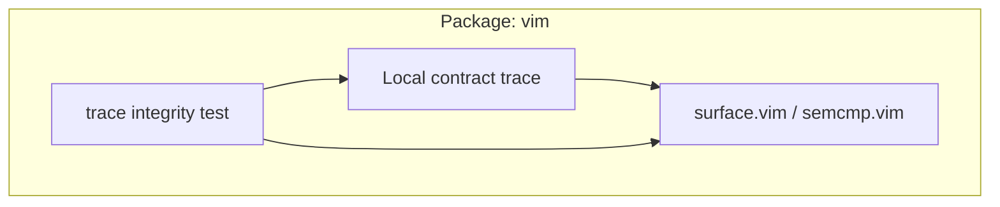
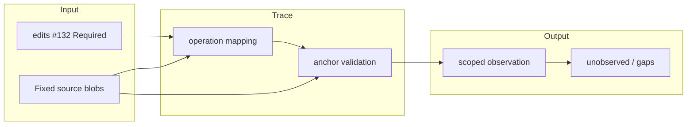

# vim contract trace — contract-batch-33

Target: [edits #132](https://github.com/roccho-dev/edits/issues/132), version `package-contract-expansion-20261029-v2`, body SHA-256 `e5f66b5c5219a28943b699858042e0d467456cc3a7ea2adf069a3d3f56367e78`.

Base: `proposals@b2f068be67be43a5f4507909a37deacf31068f56`. Branch: `contract-trace-20261029-b33-01`. Only `packages/vim/` and this batch's permitted paths may be changed.

## Purpose → Required → Provided → Observation

- `contracts.jsonl` describes this Package and seven internal operations with their supplied code anchors. Its records are local, descriptive evidence mapping, **not** organization authority or a newly adopted schema.
- `tests/contract-trace.vim` is an executable, narrow check of unique IDs, local code paths, exact source anchors and absence of false PASS declarations. It cannot establish runtime behavior, correctness of intent, source author identity, or actual Human understanding.
- Source read at base: `surface.vim` Git blob `3cfffbe8cebab65f4353337eb05f3fb6a7703079`; `semcmp.vim` Git blob `be2edc873772ff4c091d4d8fcf1afd2a9399022a`.
- Existing runtime checks live in `packages/vim/tests/surface.vim` and the root Nix fixture/installed adapter. No existing production or test file was changed by this PR.

Run from repository root on the **exact published head**, with a Vim 9 executable:

`vim -Nu NONE -i NONE -n -es -S packages/vim/tests/contract-trace.vim`

Also run the existing `nix flake check . --no-write-lock-file --print-build-logs` on the exact head. Record the checkout commit, executed command, Vim/Nix version, exit status, stdout/stderr and input revisions; do not count an earlier successful run as proof of this version.

## Explicit limits

The new check's execution is **UNOBSERVED** at submission unless a separate matching-head run is attached. The current mapping establishes that named source anchors existed in the read base files, not that the full Required is satisfied. The original Vim Human surface, semcmp ranking, actual authorized provider, cancellation and undo UX, cross-Package behavior, credentials, operational deployment, acceptance/admission, and business benefit remain unobserved by this change. No `requiredPackageContract.v1` or ADRS #692 proposal is adopted here.

## Architecture and data flow

## Adversarial boundaries

1. A duplicate contract ID invalidates the local trace.
2. A missing source anchor invalidates the local trace.
3. An anchor appearing twice invalidates the local trace.
4. An external path is not owned by this Package.
5. A missing file is not a Provided implementation.
6. A provider returning stale results is not proved safe by anchor checks.
7. An empty test run is not evidence of successful behavior.
8. A test that is skipped or not invoked remains unobserved.
9. Old branch results cannot prove the published head.
10. A valid source anchor cannot prove Human comprehension.
11. A declared implementation cannot prove acceptance.
12. A trace digest cannot authenticate its author.

## Better design / next step

Keep the descriptive JSONL inside each Package, use existing runtime suites for behavior, and add one version-bound execution observation only when it has really run. Avoid global schema additions, duplicate Required text, and claims beyond observable data. That preserves independent development and reduces false-positive acceptance.
